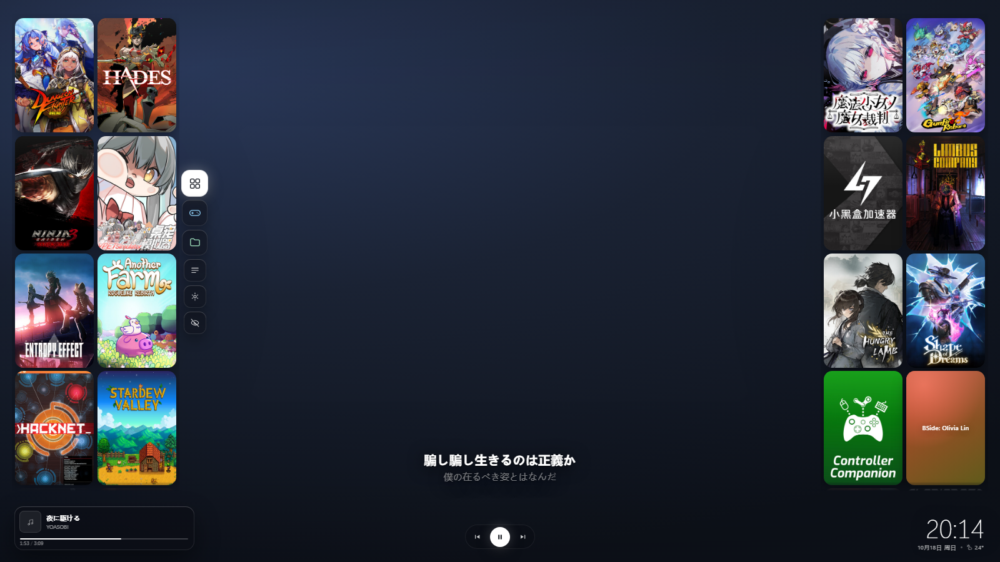
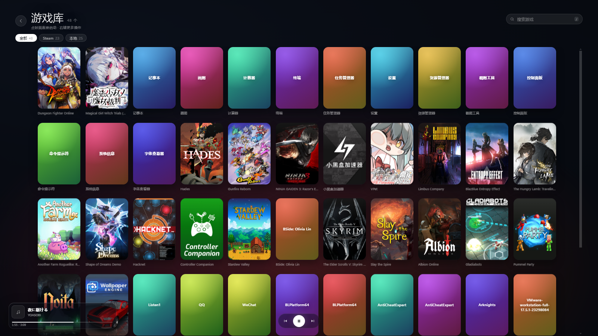
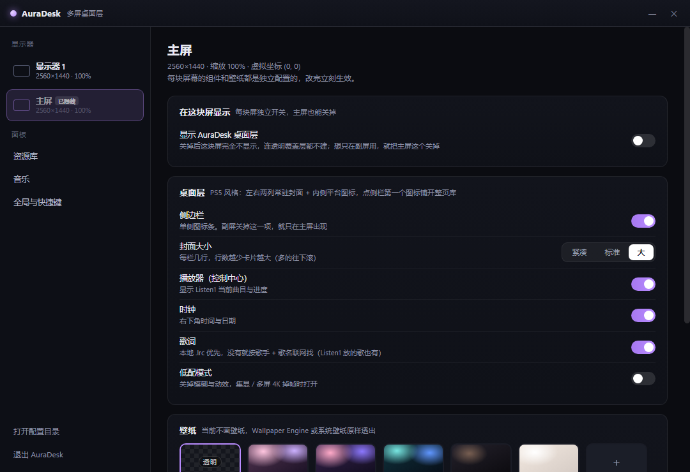

# AuraDesk

> **AI 作品声明**：本项目由 AI（腾讯 WorkBuddy 智能体）在人类指导下全程编写、调试与打包，非人类手写代码作品。采用 MIT 协议开源。

把桌面变成「PS5 风格」的覆盖层：左右两列常驻封面、一侧图标栏、左下播放器、右下角时钟。为**多显示器**场景从头设计。

| 桌面常态（真实截图） | 整页游戏库 |
| --- | --- |
|  |  |

| 悬停放大 | 设置页 |
| --- | --- |
|  |  |

## 它是什么，不是什么

**是**：一块铺满每块屏幕的**全透明**无边框窗口，贴在桌面之上、普通窗口之下。它自己**不画壁纸**，所以你的 Wallpaper Engine 动态壁纸、桌面图标都原样看得见。空白处鼠标直接穿透到桌面（图标、右键菜单照常用），只有封面 / 图标栏 / 播放器 / 时钟这些区域接收点击。`Alt+Tab` 里看不到它，不抢焦点。

**不是**：Steam 大屏模式那种独占全屏启动器——不是弹一个界面让你选游戏、切走桌面、再进游戏。桌面、任务栏、其它窗口都照常工作。

桌面常态就是「游戏库」本身：贴着屏幕左右两边各两列封面，中间整块留给壁纸，左侧封面内侧再挂一列图标（平台筛选 + 侧栏）。**点这一列里的「全部游戏」**才铺开整页库（搜索 / 分类 / 右键管理）；`Esc`、点空白处或左上角返回，回到桌面。这里只是把 PS5 的**视觉**搬过来，操作还是普通桌面软件那套鼠标 / 键盘。

## 界面

```
┌──────────────────────────────────────────────────────────┐
│ ┌────┬───┐                                        ┌───┬────┐ │
│ │ ▢  │ ▢ │  ⬤ 全部游戏                          │ ▢ │ ▢  │ │
│ │ ▢  │ ▢ │  ● Steam      ← 封面列 / 图标列       │ ▢ │ ▢  │ │
│ │ ▢  │ ▢ │  ● Epic                              │ ▢ │ ▢  │ │
│ │ ▢  │ ▢ │  ● 本地                              │ ▢ │ ▢  │ │
│ │ ▢  │ ▢ │  ────            （整块留白给壁纸）   │ ▢ │ ▢  │ │
│ │ ▢  │ ▢ │  ○ 全部游戏列表                      │ ▢ │ ▢  │ │
│ └────┴───┘  ○ 设置 / ○ 隐藏                    └───┴────┘ │
│ ┌──────────────┐             ⏮ ⏸ ⏭             18:49       │
│ │ ▢ 夜に駆ける  │                      10月18日 周日 · 24°    │
│ └──────────────┘                                            │
└──────────────────────────────────────────────────────────────┘
```

- **封面**：竖版长方形圆角卡（高 ≈ 宽 × 1.45，跟 Steam 600×900 海报几乎同比例），宽度按屏幕高度反推（设置 →「封面大小」可选 紧凑 6 行 / 标准 5 行 / 大 4 行，默认大）。每栏一屏放 N 行 × 2 列，**放不下的往下滚**（滚轮 / 触控板都行），鼠标进栏才露一条细滚动条，滚到头对应的边缘就不再渐隐；鼠标停上去卡片放大 8% + 浮出白圈 + 提亮，同时底部浮出游戏名；单击直接启动。**按住卡片拖到另一格可以调整顺序**，松手即存，下次启动还是这个排法
- **图标列只在一侧**：中间那列从上到下是 平台筛选（全部 / Steam / Epic / 本地）→ 分隔 → 侧栏（全部游戏列表 / 设置 / 隐藏）
- **整页库**：点「全部游戏列表」铺开，网格 + 来源筛选 + 搜索（`/` 聚焦），末尾一格「添加游戏」
- **播放器**：左下角封面 + 曲名 + 进度条 + 时间，控制键在底部中间，进度条可拖（Listen1 直播歌曲也能跳）。**有些播放器播放中不刷新系统媒体会话的位置**，这时按本地时钟插值往前走，暂停时会自动对齐到准确位置
- **时钟**：右下角，大号时间 + 日期 + 天气
- **触屏 / 触控笔（Surface 等）**：输入区域按热区动态裁剪（Windows 原生窗口形状），空白处系统级穿透——手指、Surface Pen、鼠标统一零延迟命中，没有轮询也没有全局钩子。点按即启动，**长按卡片（约半秒）弹出右键菜单**，拖动换位同样可用；笔悬停有放大预览。封面栏的卡片间隙可以直接划动滚动

## 卡片就是任务栏（启动器兼任务切换器）

AuraDesk **不做一条横条去覆盖 Windows 任务栏**——任务栏的功能直接融进桌面层：

- **悬停状态气泡 + 实时预览**：卡片对应的程序正在运行时，鼠标悬停封面放大的同时，旁边弹出聊天气泡——里面直接显示**该窗口当前的实时画面**（PrintWindow 抓取，Chrome / Edge 等 GPU 渲染窗口同样支持，悬停期间低频刷新防闪）；「运行中 · 正在前台」绿点提示 / 「运行中 · 在后台」/ 「运行中 · 最小化 · 最后画面」（最小化的窗口显示收起前的画面）。**气泡本身可以点击**，点击 = 打开 / 切换到该程序；没运行的卡片不打扰
- **点击 = 任务切换**：程序在运行，点卡片直接切换到那个窗口（再点已在前台的 = 最小化，同任务栏习惯）；没运行才启动。**启动器就是任务栏**，不需要第二个窗口列表
- **窗口切换用 `AttachThreadInput` 抢前台**：从覆盖层点击也能可靠把窗口弹到前面，不会被系统静默拒绝
- **控制舱**：时钟旁一个小圆钮，弹出面板——音量滑块 + 静音，**输出设备 / 输入设备直接列出、点一下即切换系统默认设备**（不用进系统设置的音量合成器），最下面一个「显示桌面」按钮（等价 `Win+D`）
- 状态由常驻 PowerShell 助手每 1.5 秒扫描窗口得到（自动滤掉系统壳进程与隐藏 UWP），不抄微软的样式，也没有常驻横条

## 边缘任务条（所有运行中程序，随叫随到）

鼠标推到屏幕**上边缘或下边缘**（设置可选）停住约半秒，一条**运行程序卡片条**从边缘滑出：

- **桌面卡片同款样式**：圆角玻璃、紫色描边、悬停放大、名称浮现——不是微软任务栏那种横条
- **卡片内容 = 窗口实时画面**：每张卡片直接铺那个窗口当前的实时内容，面板打开期间每 3 秒整轮刷新，收起即停（零开销）；最小化的程序显示收起前的最后画面
- **点击直接切换**：与桌面卡片同一条切换链路（`AttachThreadInput` 抢前台），前台程序绿点高亮排在最前
- **永远置顶**：独立 `screen-saver` 级置顶窗口，不被任何应用覆盖；平时整条藏在屏幕外，只留 3px 全透明触发条
- **绝不挡操作**：热区按状态精确放行（Windows 原生形状穿透）——收起时只有 3px 边缘，程序标题栏的最小化 / 关闭按钮照常可点
- **多屏各自独立**：每块屏一条、各自触发，设置里可按屏开关；全局可选顶部 / 底部位置
- 触发判定在主进程轮询光标完成（150ms / tick），不依赖透明边缘的鼠标事件，物理上必然可靠

## 和 Wallpaper Engine 共存

这是设计前提，不是事后补的。四层保证：

1. **不挂 WorkerW。** 不抢 Wallpaper Engine 的壁纸层，两者是完全独立的窗口。
2. **默认不画任何壁纸。** 窗口是 `transparent: true` + 全透明背景，只叠组件。设置里的「壁纸」默认就是**跟随桌面**。
3. **永远不会成为前台窗口。** 窗口带 `focusable: false`（即 `WS_EX_NOACTIVATE`）+ `showInactive()`，从不进 `Alt+Tab`、从不抢焦点。Wallpaper Engine 判断「全屏应用时暂停壁纸」看的是前台窗口，而它永远不是。
4. **不做整窗毛玻璃。** 透明窗口里 `backdrop-filter` 采不到别的进程的画面，会渲染成一块死色，所以全部关掉，改用「半透明实心 + 内侧高光」。

唯一会碰壁纸的是边缘那层很淡的压暗（保证任何壁纸上文字都读得清）。设置里把它拉到 0 就完全没有了。

## 游戏从哪来（不限平台）

| 来源 | 扫描方式 | 封面 | 启动方式 |
| --- | --- | --- | --- |
| **开始菜单 / 桌面** | 扫两处 Start Menu + 桌面里的 `.lnk`，用 `WScript.Shell` 批量解析目标程序与参数。**任何启动器（GOG / Ubisoft / EA / Battle.net / Riot / 米哈游 / 独立游戏）装了就会留快捷方式** —— 这条路不挑平台 | 按名字去 Steam 商店 + Epic 缓存里找 | 直接开 `.lnk`，`ShellExecute` 会处理参数、工作目录、管理员标记 |
| **Steam** | 注册表定位 → `libraryfolders.vdf` → `appmanifest_*.acf`，按 `StateFlags & 4` 只取已安装，过滤 Redistributable / Proton；注册表读不到时按盘符兜一圈 | 官方 CDN 的 `library_600x900.jpg` | `steam://rungameid/<appid>` |
| **Epic** | `%ProgramData%\Epic\...\Manifests\*.item`，过滤 `AppCategories` 不含 `games` 的项 | 启动器自己的目录缓存 `catcache.bin`（base64 JSON）里的 `DieselGameBoxTall`，**不需要 Key** | 官方 `com.epicgames.launcher://apps/...`，失败退 exe |
| **手动** | 多选 exe / 快捷方式，或扫目录（向下 2 层，按体积和文件名猜主程序） | 可手动指定，也可自动补 | `shell.openPath` |

**渲染时还会再兜一层**：本地缓存的图不在（缓存目录被清理、换机器）就直接拉 Steam CDN 的线上海报，两张都失败才退回色块。**封面多级回退**，前四级都免费：

1. Epic 商店在线搜索（GraphQL，免 Key，竖版，标题精确同名优先、前缀匹配里取最短——「Hades」不会抓成「Hades + Soundtrack」）
2. Epic 启动器本地目录缓存（`catcache.bin`）
3. Steam 本机安装目录反查 appid（`appmanifest_*.acf`，注册表定位）→ 官方 CDN 竖图
4. Steam 商店搜索 `storesearch`（部分网络环境不通，4.5 秒短超时）
5. SteamGridDB（这一步才需要免费 Key）

**本地手动添加的程序同样吃这套回退**：添加后 1.4 秒自动跑一轮匹配，能在 Steam / Epic 找到的直接用官方海报；全都找不到才用「原图标居中 + 模糊背景」的兜底卡。没匹配到的名字会记进 miss 名单，7 天内不重复白跑（网络恢复或装了新游戏后自动再试）。所以从开始菜单导入的米哈游、GOG 游戏也能自动配上官方竖版封面。

没有海报、也匹配不到封面时，卡片不是色块：用 Windows Shell 抠出 exe / 快捷方式里的原生图标（最大 256×256），**原图标居中、同一张图放大模糊铺满当背景**。

## 声音：只捕捉 Listen1

默认音源就是 **Listen1**，不需要装插件，也不接管它的播放。

- 走 Windows 媒体会话（SMTC）：读曲名、艺术家、封面、播放状态、进度，**不额外发声**。
- 播放 / 上一首 / 下一首 / **拖动进度条**全部转发给 Listen1 自己处理 —— 拖动用的是 `TryChangePlaybackPositionAsync`（100ns tick），实测 Listen1 会接受并跳转。
- 多个播放器同时开着时（比如浏览器在放视频），会话嗅探**优先选 Listen1**，其次选正在播放的，最后才用系统当前会话。
- 控制指令走**常驻进程**（stdin 逐行喂命令），第一次点按付一次 PowerShell 启动成本（约 450ms），之后每次 < 50ms。
- 歌词：SMTC 本身不带歌词，按「歌手 + 歌名（+ 时长）」联网找一份带时间轴的 LRC（先网易云，再 lrclib 兜底），按歌手 + 歌名缓存到 `cache/lyrics/`，同一首歌第二次是 0 网络。播放器上方居中显示当前句 + 下一句预览。

> 拖动进度条以前无效：旧实现里直播歌曲直接 `return`，压根没发指令。现在拖动中只做本地预览，松手才发一次 seek，松手后的 800ms 轮询会用真实进度纠正。

## 下载安装

到 [Releases](https://github.com/nishidsb/auradesk/releases/latest) 下载，二选一：

| 文件 | 适合 | 说明 |
| --- | --- | --- |
| `AuraDesk-Setup-x.x.x.exe` | 大多数人 | 一键安装器：可选安装目录，自动建桌面 / 开始菜单快捷方式，带卸载入口 |
| `AuraDesk-Portable-x.x.x.exe` | 免安装党 | 单文件绿色版，双击即用，配置同样存在 `%APPDATA%/auradesk/`，删掉文件即卸载 |

安装版默认装到 `%LOCALAPPDATA%\Programs\AuraDesk`，不写注册表垃圾、不需要管理员权限。开机自启走任务计划 / 注册表 Run 项，托盘右键可随时关。

## 快速开始（源码运行）

```bash
npm install
npm start          # 启动，每块显示器一个覆盖层窗口
npm run demo       # 内置示例曲目，预览播放器与歌词
```

首次启动会打开设置面板。左侧列出所有显示器，点任意一块单独配置。

| 操作 | 说明 |
| --- | --- |
| 托盘图标 · 单击 | 打开设置 |
| 托盘图标 · 右键 | 显隐桌面层 / 开机自启 / 打开配置目录 / 退出 |
| `Ctrl+Alt+A` | 显示 / 隐藏全部覆盖层 |
| `Ctrl+Alt+S` | 打开设置 |
| 侧栏封面 · 单击 | 直接启动 |
| 侧栏封面 · 右键 | 启动 / 打开文件位置 / 从库中移除 |
| 平台图标 | 只看这一家 / 再点回到全部 |
| 侧边栏 · 第一个图标 | 铺开整页游戏库 / 收回到桌面 |
| 游戏库 · 单击封面 | 直接启动 |
| 游戏库 · 右键封面 | 启动 / 打开文件位置 / 从库中移除 |
| 游戏库 · `↑↓←→` `Enter` | 网格内移动、启动 |
| 游戏库 · `/` | 聚焦搜索框 |
| `Esc` | 收起右键菜单 / 退出游戏库 |

关掉设置窗口、或按快捷键隐藏桌面层都**不会退出**软件，托盘图标一直在，退出统一走托盘菜单。

## 多屏是怎么处理的

**1. 一块屏幕一个窗口，不是一块大窗口横跨所有屏**

多屏不同分辨率、不同 DPI（比如 4K@150% + 1080p@100%）下，跨屏大窗口必然出问题：缩放任一屏都会让另一屏模糊，窗口坐标按最大屏算还会错位。所以用 `screen.getAllDisplays()` 枚举，每块屏建一个尺寸精确等于 `display.bounds` 的窗口。

**2. 每块屏单独开关，主屏也能关**

以前只有一个「只在主屏显示」的总开关，主屏没法隐藏。现在改成**每屏一个**「在这块屏显示」开关：关掉的那块屏连透明窗口都不建，设置左侧列表会标「已隐藏」。所以「只在副屏用」就是——把主屏关掉、副屏打开。侧边栏、播放器、时钟这些组件同样按屏独立。

老配置里的「只在主屏显示」会在升级时自动换算成「副屏关、主屏开」，不用手动重设。

**3. 按屏幕实际 DIP 尺寸换算 UI 比例**

`ui = clamp(屏幕高度 / 1080)`，再乘手动微调系数，写进 CSS 根字号，全站 `rem` 布局。1440p 卡片和字号同比放大；1080p@125%（DIP 只有 1536×864）自动收小，物理观感一致。

**4. 声音只有一个源**

SMTC 模式下状态本来就在主进程，广播给所有屏；本地文件模式下只有主屏窗口持有 `<audio>`。插拔副屏、重建窗口都不会打断播放，也不会两屏同时出声。

**5. 显示器热插拔自动重建**

监听 `display-added` / `display-removed` / `display-metrics-changed`，400ms 防抖后重建窗口，配置按 `display.id` 保留。

**6. 鼠标穿透按元素命中动态开关**

窗口默认 `setIgnoreMouseEvents(true, { forward: true })` 全穿透；渲染层用 `elementFromPoint` 判断光标是否落在带 `data-hot` 的元素上，命中才解除。库面板打开时整屏可交互，所以点空白处能关掉它。

## 配置面板

- **桌面层**：本屏显示开关 + 侧边栏、播放器、时钟、歌词、封面大小、低配模式
- **壁纸**：默认「跟随桌面」（不画壁纸）；也可选 5 套内置渐变或本地图片，并可调边缘压暗 / 模糊 / 放大裁切
- **界面比例**：整体缩放
- **资源库**：从开始菜单导入（带搜索 / 全选）、导入 Steam、导入 Epic、手动添加、扫目录、换封面、改名、删除、一键补全封面
- **音乐**：音源切换（Listen1 系统媒体会话 / 本地文件），显示当前会话

配置文件在 `%APPDATA%/auradesk/config.json`（设置里可直接打开）。配置 v1 → v3 自动迁移：老的自绘壁纸改成「跟随桌面」，重复的游戏库图标去掉。

## 目录结构

```
src/main/main.js              多屏窗口、IPC、播放状态、托盘、导入调度
src/main/store.js             config.json 读写、默认值、版本迁移
src/main/library.js           exe 扫描、音乐元数据、LRC 解析
src/main/lyrics.js            在线歌词（网易云 → lrclib 兜底，磁盘缓存）
src/main/sources/startmenu.js 开始菜单 / 桌面快捷方式（任意平台）
src/main/sources/steam.js     Steam 库扫描 + CDN 封面
src/main/sources/epic.js      Epic manifest 扫描 + 目录缓存封面
src/main/sources/covers.js    封面三级回退（Epic 缓存 / Steam 商店 / SGDB）
src/main/sources/smtc.js      系统媒体会话桥（轮询 + 常驻控制进程 + seek）
src/main/launcher.js          启动器状态桥：卡片运行状态匹配 / 窗口截图 / 音量 / 音频设备 / 显示桌面
src/main/edgebar.js           边缘任务条（每屏独立置顶窗口 + 光标轮询触发）
src/main/logger.js            诊断文件日志（%APPDATA%/AuraDesk/logs/main.log）
src/main/resources/*.ps1      SMTC 读取 / 控制、.lnk 解析、launcher 助手（窗口枚举 / AttachThreadInput 抢前台 / PrintWindow 截图 / 音频设备切换，纯 ASCII，避开 PS 5.1 的 ANSI 解析）
src/main/resources/*.png      托盘 / 应用图标（tools/make-tray.js 生成）
src/preload/*.js              contextBridge 暴露的受限 API
src/renderer/overlay          覆盖层（两侧封面 / 整页库 / 悬停实时预览气泡 / 播放器 / 时钟 / 控制舱）
src/renderer/edgebar          边缘任务条（运行程序卡片 / 实时画面直显）
src/renderer/settings         设置面板
tools/                        预览页、jsdom 冒烟测试、解析器自检、图标生成
```

## 自测

```bash
npm test           # Steam / Epic / 开始菜单解析 + 常驻控制进程 + 5 组 jsdom 冒烟
npm run preview    # 生成浏览器可直接打开的预览页（overlay / library / settings）
npm run capture    # 真机启动并截图到 captures/
npm run icons      # 重新生成托盘图标
```

## 还没做的

2. **小部件真实动作**：聊天 / 录制 / 助手图标目前是占位提示，要接各自启动目标
3. **歌词准确性**：现在按歌名 + 歌手 + 时长匹配，翻唱 / 现场版偶尔会串；介意的话把同名 `.lrc` 放到音乐目录里，会优先用本地的
4. **窗口层级微调**：目前靠 Windows 自然 z-order，要强制常驻「桌面之上、所有窗口之下」需要 `SetParent` 到 Progman

## 打包

```bash
npm run dist       # 同时产出 NSIS 安装器 + 便携版单文件
npm run dist:dir   # 只出不打包的目录版（调试用）
```

产物在 `dist/`：`AuraDesk-Setup-x.x.x.exe`（安装器）、`AuraDesk-Portable-x.x.x.exe`（绿色版）。

打包要点：运行时要调用的 `resources/*.ps1`（SMTC 轮询 / 控制、.lnk 解析）必须 `asarUnpack`，外部 PowerShell 进程读不了 asar 包内路径；代码里用 `unpackedPath()` 把 `app.asar` 重写成 `app.asar.unpacked`，开发环境原样返回，两边通用。
